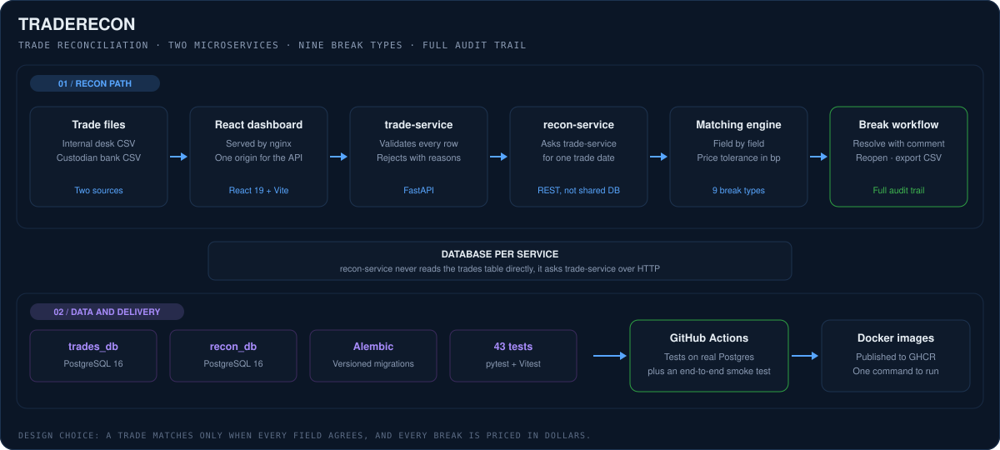
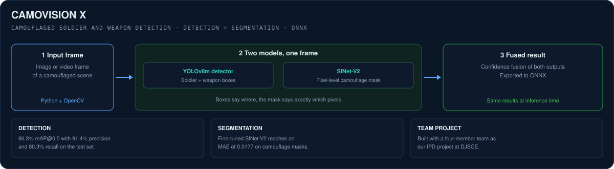
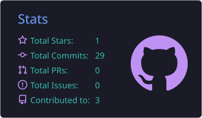
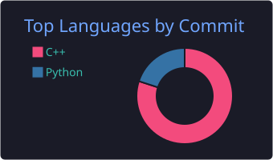

  
   
   
  
  
  
  

 

## 👋 About Me

I'm Akshat, an Information Technology student at D. J. Sanghvi College of Engineering in Mumbai. I'm most at home where machine learning meets the real world, and the question I keep coming back to is this: can a model see what a person would miss, and can we trust it when it does?

That question is what pulled me towards **computer vision**. Detecting a soldier hidden in foliage, or a rider without a helmet in a crowded junction, is only useful if the model is right often enough to act on. So I care about the whole pipeline around the model: the data it learns from, how it's measured, and how its results reach the people who need them.

On the ML side, I worked on **CamoVision X**, a detection and segmentation pipeline for camouflaged soldiers and weapons, and I'm now building an **AI traffic system** for Indian roads. On the backend side, I built **TradeRecon**, a microservices platform that reconciles trades between a trading desk and a custodian bank.

Most days also include some competitive programming. I've solved 560+ DSA problems in C++, and I enjoy the way a hard problem forces you to think clearly. Away from the screen, you'll find me into athletics, reading, or exploring whatever new tech has caught my attention.

 

  <table>
    <tr>
      <td align="center" width="33%"><h3>👁️ Computer Vision</h3>Detection, segmentation and tracking</td>
      <td align="center" width="33%"><h3>🧱 Backend systems</h3>FastAPI, PostgreSQL, Docker and CI/CD</td>
      <td align="center" width="33%"><h3>🧮 Problem solving</h3>560+ DSA problems in C++</td>
    </tr>
  </table>

---

## 💼 Experience & Leadership

<table>
  <tr>
    <td width="24%" valign="top">
      <h3>CSI DJSCE</h3>
      <b>Operations Team Member, Logistics</b> 
      2025 to Present  
      
    </td>
    <td valign="top">
      I'm part of the operations team for the DJSCE chapter of the Computer Society of India, where I handle logistics for the chapter's events. I manage budgets and procurement for the creatives team, work with vendors and negotiate prices to bring costs down, and fix the bottlenecks that slow an event down before they turn into problems on the day.
        
      <b>What this taught me:</b> most problems are cheaper to solve before they happen. Planning for the thing that goes wrong is the same habit that makes software reliable.
    </td>
  </tr>
</table>

---

## 🚀 Featured Project: TradeRecon

  
  
  

**A platform that finds every trade the desk and the bank disagree on, and shows how much money is at risk.**

If a trade is booked one way by a firm and another way by its custodian bank, positions, cash and P&L are wrong until someone notices. Banks, brokers and funds run this check every day. I wanted to build it the way a real team would: separate services with their own databases, a matching engine that explains every mismatch, and a dashboard an operations analyst could actually work from.

  

### How the system works

| Module | What happens | Why it's built this way |
|---|---|---|
| **trade-service** | Ingests CSV trade files from the desk and the custodian, validates every row and reports rejected rows with reasons. | Bad input should be caught at the door, with a reason a person can act on. |
| **recon-service** | Pulls both sides for a trade date from trade-service over REST and runs the matching engine. | Each service owns its own database, so neither one depends on the other's tables. |
| **Matching engine** | Compares trades field by field and detects 9 break types, from missing trades to price, quantity and settlement-date mismatches. | A trade only matches when every field agrees. Anything else is a break that needs a look. |
| **Exposure** | Every break is priced in dollars, with a configurable price tolerance in basis points. | Analysts need to know which break to fix first, and the dollar amount tells them. |
| **Break workflow** | Breaks are resolved with a mandatory comment and analyst name, can be reopened, and export to CSV. | In finance, every change has to be explainable later. That's what the audit trail is for. |
| **Dashboard** | Open breaks, open exposure, latest match rate, breaks by type and run history. | The numbers that matter most should be visible without digging. |
| **Database** | PostgreSQL 16 with versioned Alembic migrations, constraints and indexes. | Schema changes are tracked like code, so the database never drifts. |
| **Tests and delivery** | 43 tests (pytest and Vitest) run against real PostgreSQL in GitHub Actions, then Docker images publish to GHCR. | If it isn't tested against the real database, it isn't really tested. |

**Stack:** Python, FastAPI, Pydantic, SQLAlchemy, PostgreSQL, React, Docker, nginx, pytest, Vitest, GitHub Actions.

[Explore the code in the repository](https://github.com/AKSHAT200905/Trade-reconciliation-platform)

---

## 🧩 More Projects

### 01. CamoVision X · IPD Team Project

  

Camouflage is designed to fool the human eye, which makes it a hard problem for a model too. CamoVision X is a pipeline that finds **camouflaged soldiers and weapons** in an image. A YOLOv8m detector draws boxes around soldiers and weapons, while a fine-tuned SINet-V2 model marks the exact pixels that belong to a camouflaged target. The two outputs are combined with confidence fusion, and the whole pipeline is exported to ONNX so it behaves the same at inference time.

The detector reached **86.3% mAP@0.5** with **91.4% precision and 80.3% recall**, and the segmentation model reached an **MAE of 0.0177**. In plain words, when it flags a target it's usually right, and the remaining misses show where camouflage is still winning. I built it with a four-member team as our IPD project.

**Stack:** Python, PyTorch, YOLOv8m, SINet-V2, OpenCV, ONNX.

### 02. AI Traffic System · In progress

I'm currently building an AI-based traffic system for Indian roads with [Yashi](https://github.com/yashishah176). It detects five kinds of violations from CCTV footage: red-light jumping, wrong-side driving, triple riding, riding without a helmet and overspeeding. It reads number plates, falls back on appearance-based re-identification when a plate is hidden, and logs evidence with a cryptographic hash so it can't be quietly changed. We're comparing YOLOv10m and YOLOv8m at every phase, trained on IISc's UVH-26 dataset, which includes two-wheelers. I'll add the repository here once it's ready.

**Stack:** Python, YOLOv10m, YOLOv8m, OpenCV, ANPR, Jupyter.

### 03. Data Structures & Algorithms · Ongoing

My running collection of DSA solutions in C++, from arrays and hashing to recursion, linked lists, trees, graphs and dynamic programming. It's where most of my 560+ solved problems end up, written the way I'd write them in a contest.

**Stack:** C++. · [Explore the code in the repository](https://github.com/AKSHAT200905/Data-Structures-and-Algorithms)

---

## 🏆 Achievements & Certifications

- **Competitive programming:** 560+ DSA problems solved in C++ · LeetCode 375+ · CodeChef 2★ (1500+) · Codeforces Pupil (1233)
- **Amazon ML Challenge 2026**: built a business entity resolution pipeline across noisy US, India and France data sources
- **Certifications:** Bayesian Statistics: From Concept to Data Analysis (UC Santa Cruz) · Data Processing and Optimization with Generative AI (Microsoft) · Agentic AI and AI Agents: A Primer for Leaders (Vanderbilt) · Using Descriptive Statistics to Analyze Data in R · CCNA: Introduction to Networks (Cisco)

  
  
  

---

## 🐍 GitHub Contribution Snake

  

  
  

---

## 🛠️ Technical Skills

  

| Area | Tools and concepts I've worked with |
|---|---|
| **Languages** | C++, Python, Java, C, SQL, R, JavaScript, HTML, CSS |
| **ML and vision** | PyTorch, YOLOv8, YOLOv10, SINet-V2, OpenCV, ONNX, scikit-learn, Hugging Face |
| **Data** | Pandas, NumPy, PostgreSQL, MySQL, Oracle, Excel |
| **Backend** | FastAPI, Pydantic, SQLAlchemy, REST APIs, React |
| **DevOps** | Docker, Docker Compose, GitHub Actions, CI/CD |
| **Tooling** | Git, GitHub, VS Code, Jupyter, Linux |

---

## 🌱 What I'm Exploring

- **Object detection and segmentation:** getting models to find small, hidden or crowded objects reliably.
- **Model optimization:** making models faster and lighter with ONNX, without losing accuracy.
- **Tracking and re-identification:** following the same object across frames and across cameras.
- **Scalable backend systems:** services, databases and pipelines that hold up when the data grows.

## 📬 Connect

I'm always happy to talk about computer vision, ML projects, competitive programming, or anything new you're building. And if you need one more person for a hackathon team, I'm in.

  
  
  

 

  Built with curiosity, a lot of dry runs, and one bug fix at a time.

